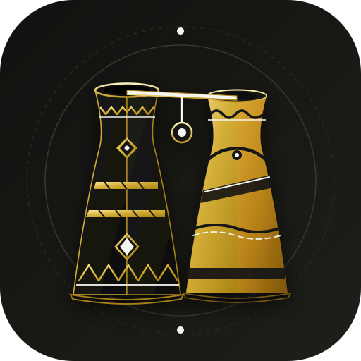

<p align="center">
  
</p>

# inqaba

Shared Python framework boundaries for RAIkeep. The public API begins with
`Inq*` names and currently provides typed path, file, and configuration
objects for the active Python projects. Command and media APIs remain planned.

```python
from inqaba import InqPath, InqRelPath

root = InqPath.from_directory("/srv/jsonpit/")
people = root / InqRelPath("People")
person_file = people / "Person.pit"
```

`InqRelPath` represents directory segments. A terminal filename is supplied as
a string and is not itself a relative directory path.

See the [rendered class diagram](doc/inqaba-class-diagram.svg), its
[PlantUML source](doc/inqaba-class-diagram.puml), and the
[migration contract](doc/MIGRATION.md). For release verification, use the
paired Umgodi `scripts/preflight.py` with both repositories checked out.
